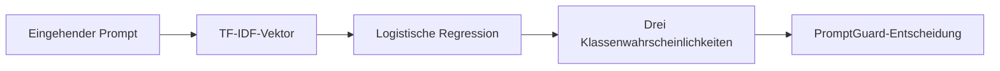
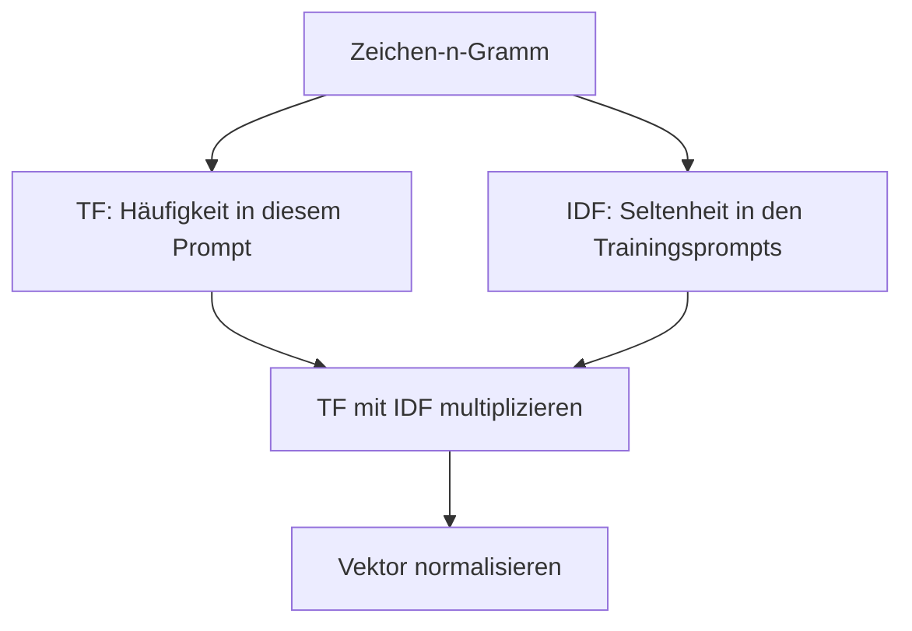
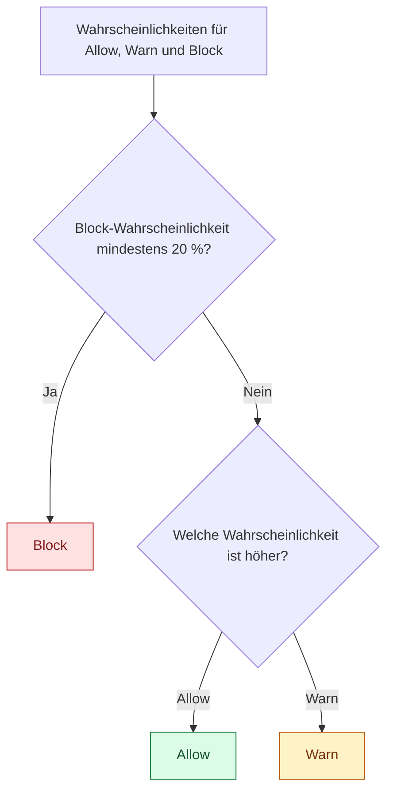

# Wie PromptGuard TF-IDF und logistische Regression nutzt

PromptGuard wählt für jeden eingehenden Prompt eine von drei Aktionen. **Allow** lässt den Prompt durch, **Warn** markiert ihn mit einem Hinweis, und **Block** stoppt ihn. TF-IDF übersetzt den Text in Zahlen. Die logistische Regression schätzt daraus die Wahrscheinlichkeit jeder Klasse. Anschließend wendet PromptGuard seine Entscheidungsregel an.

## 1. TF-IDF wandelt Text in numerische Merkmale um

PromptGuard verwendet **Zeichen-n-Gramme**, also kurze, überlappende Zeichenfolgen. Mit der standardmäßigen Kleinschreibung in scikit-learn wird aus „IBAN“ zunächst „iban“. Daraus entstehen unter anderem „ib“, „ba“, „an“, „iba“, „ban“ und „iban“. Der Analyzer `char_wb` ergänzt Wortgrenzen um Leerzeichen und bildet die n-Gramme innerhalb dieser erweiterten Wortgrenzen. Bei einem Tippfehler bleiben oft mehrere Fragmente erhalten. Dasselbe Verfahren lässt sich für verschiedene Sprachen und für Muster aus Ziffern und Satzzeichen verwenden.

- **TF (Term Frequency)** gibt an, wie oft ein Merkmal im aktuellen Prompt vorkommt. Mit `sublinear_tf=True` ergibt die Formel `1 + ln(Anzahl)` bei einem Vorkommen den Wert 1 und bei drei Vorkommen etwa 2,10.
- **IDF (Inverse Document Frequency)** gewichtet Merkmale höher, die in wenigen Trainingsprompts vorkommen. Wenn „iban“ und „plea“ im aktuellen Prompt jeweils einmal vorkommen, erhält „iban“ den höheren TF-IDF-Wert, sofern es in weniger Trainingsprompts vorkommt.
- Der **TF-IDF-Vektor** enthält einen Wert pro Merkmal im Vokabular. Fehlt ein Merkmal im Prompt, steht an seiner Position eine 0. Die standardmäßige L2-Normalisierung skaliert einen Vektor mit mindestens einem positiven Wert auf die Länge 1.

Der Vektorisierer lernt das Vokabular und die IDF-Werte aus den Trainingsdaten. Für Validierungsdaten, Testdaten und neue Prompts verwendet er dieselben Werte.

### Einstellungen des Vektorisierers

| Parameter | Wert im Projekt | Bedeutung |
|---|---|---|
| `analyzer` | `char_wb` | Bildet Zeichenfolgen innerhalb der um Leerzeichen erweiterten Wortgrenzen. |
| `ngram_range` | `(2, 5)` | Berücksichtigt Zeichenfolgen mit zwei bis fünf Zeichen, von kurzen Fragmenten bis zu längeren Mustern. |
| `min_df` | `5` | Behält Merkmale, die in mindestens fünf Trainingsprompts vorkommen. Ein höherer Wert verkleinert das Vokabular und kann nützliche seltene Merkmale entfernen. |
| `max_features` | `300_000` | Begrenzt das Vokabular auf die häufigsten verbleibenden Merkmale, gemessen an ihren Vorkommen im gesamten Trainingskorpus. Eine niedrigere Grenze spart Speicher. |
| `sublinear_tf` | `True` | Schwächt den Einfluss von Wiederholungen innerhalb eines Prompts ab. |

[scikit-learn-Dokumentation zu TfidfVectorizer](https://scikit-learn.org/stable/modules/generated/sklearn.feature_extraction.text.TfidfVectorizer.html)

## 2. Logistische Regression schätzt die Klassenwahrscheinlichkeiten

Beim Training sieht das Modell Prompts, die als `allow`, `warn` oder `block` gelabelt sind. Es lernt für jede Klasse ein Gewicht pro Merkmal und einen konstanten Term (Intercept). Dazu minimiert es einen gewichteten Log Loss mit Regularisierung. Bei der Vorhersage multipliziert es jeden TF-IDF-Wert mit dem gelernten Gewicht der jeweiligen Klasse und addiert alle Beiträge sowie den Intercept. **Softmax** wandelt die drei Klassenscores in Wahrscheinlichkeiten um, die zusammen 100 % ergeben.

**Klassenscore = Intercept + Summe aller Produkte aus TF-IDF-Wert × gelerntem Klassengewicht**

### Rechenbeispiel

Für den Prompt „Summarise this IBAN example“ betrachten wir in einem vereinfachten Modell zwei aktive Merkmale. `summ` hat den TF-IDF-Wert 0,60 und `iban` den Wert 0,80. Die Gewichte und Ergebnisse dienen der Veranschaulichung.

| Klasse | Intercept | Beitrag von `summ` | Beitrag von `iban` | Klassenscore | Softmax-Wahrscheinlichkeit |
|---|---:|---:|---:|---:|---:|
| Allow | +0,40 | 0,60 × 1,20 | 0,80 × −0,40 | 0,80 | 47,2 % |
| Warn | 0,00 | 0,60 × 0,00 | 0,80 × 0,50 | 0,40 | 31,6 % |
| Block | 0,00 | 0,60 × −0,80 | 0,80 × 0,60 | 0,00 | 21,2 % |

### Einstellungen für Training und Entscheidung

| Einstellung | Wert im Projekt | Bedeutung |
|---|---|---|
| `C` | `1` in der Baseline, `30` in der abgestimmten Variante | Steuert die Regularisierung. Ein kleinerer Wert begrenzt die Gewichte stärker. Ein größerer Wert ermöglicht eine engere Anpassung an die Trainingsdaten und kann Overfitting begünstigen. |
| `class_weight` | `"balanced"` | Gewichtet Trainingsbeispiele aus selteneren Klassen im Log Loss stärker. |
| Block-Schwelle | `0.20` in der abgestimmten Variante | Gibt `block` Vorrang, sobald die geschätzte Block-Wahrscheinlichkeit 20 % erreicht. Diese Regel wird nach der Vorhersage angewendet. |

Für die Reproduzierbarkeit könnt ihr aus eurem Trainingscode die scikit-learn-Version, den Optimierer (`solver`), die Regularisierungsart und `max_iter` ergänzen. Die Softmax-Erklärung setzt eine multinomiale logistische Regression voraus, die der gewählte Solver unterstützen muss.

[scikit-learn-Dokumentation zu LogisticRegression](https://scikit-learn.org/stable/modules/generated/sklearn.linear_model.LogisticRegression.html)

## 3. PromptGuard wendet die Block-Schwelle an

| P(Allow) | P(Warn) | P(Block) | Klasse mit der höchsten Wahrscheinlichkeit (Argmax) | PromptGuard-Aktion |
|---:|---:|---:|---|---|
| 75 % | 15 % | 10 % | Allow | **Allow** |
| 30 % | 55 % | 15 % | Warn | **Warn** |
| 47,2 % | 31,6 % | 21,2 % | Allow | **Block** |

Im Rechenbeispiel hat **Allow** die höchste Wahrscheinlichkeit. PromptGuard gibt trotzdem **Block** aus, weil die Block-Wahrscheinlichkeit von **21,2 %** über der Schwelle von **20 %** liegt. Eine niedrigere Schwelle kann mehr tatsächliche Block-Fälle erfassen und zugleich zu mehr fälschlichen Blockierungen führen. Ob die ausgegebene Wahrscheinlichkeit das tatsächliche Risiko widerspiegelt, hängt von der Kalibrierung des Modells ab.

## 4. Ergebnisse auf dem Validierungsdatensatz

| Variante | Makro-F1 | Recall für Block |
|---|---:|---:|
| Baseline (`C = 1`, Argmax) | 0,870 | 91,8 % |
| Abgestimmte Variante (`C = 30`, Block-Schwelle 0,20) | 0,864 | **95,5 %** |

Die abgestimmte Variante erreichte das Projektziel, **mindestens 95 % der als Block gelabelten Prompts** auf dem Validierungsdatensatz zu blockieren. Der Recall für Block stieg um **3,7 Prozentpunkte**, der Makro-F1 sank um **0,006**. Beim Makro-F1 zählt der F1-Wert jeder Klasse gleich viel. Die gemessene Vorhersagezeit lag laut euren Angaben bei etwa **3 ms pro Prompt**.

Da ihr `C` und die Entscheidungsregel gleichzeitig geändert habt, zeigt die Tabelle ihren gemeinsamen Effekt. Für die Auswahl der Einstellungen könnt ihr `C` und die Schwelle mit Validierungsdaten prüfen und die gewählte Konfiguration anschließend auf einem separaten Testdatensatz bewerten.

## Was das Modell erklären kann

Für jede Vorhersage lässt sich berechnen, welche Zeichenfolgen den Score einer Klasse erhöht oder gesenkt haben. Damit kann das Modell wiederkehrende Schreibweisen und Formate erfassen. Da es die Beiträge einzelner Merkmale addiert, erfasst es den Kontext nur begrenzt. So kann es Teile von „anna“ mit Personennamen verbinden und trotzdem einen Namen in einem neuen Kontext übersehen oder eine allgemeine Erwähnung sensibler Informationen markieren.
