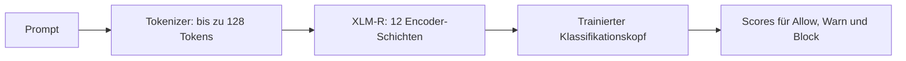
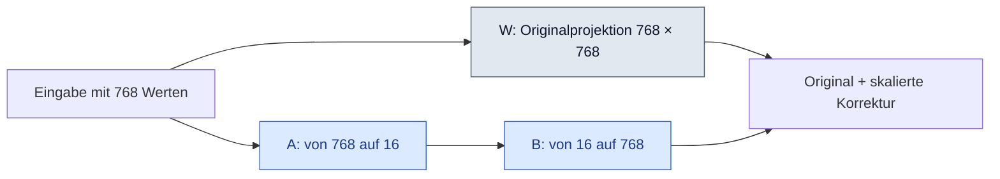
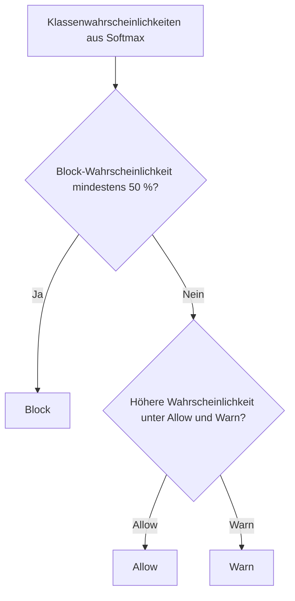

# PromptGuard – XLM-RoBERTa mit LoRA einfach erklärt

## Warum wir einen Encoder ausprobieren

[TF-IDF](01_tfidf.md) mit [logistischer Regression](02_logistische_regression.md) oder [linearer SVM](03_lineare_svm.md) bewertet kurze Zeichenfolgen. Die Modelle können lernen, welche Fragmente häufig mit **Warn** zusammen auftreten. Der Zusammenhang im Satz geht dabei weitgehend verloren.

Nach dem Training mit harmlosen Prompts ließ die beste SVM in einem Check **15 von 60 Warn-Prompts** durch. Ein Beispiel war „Schreib eine Geburtstagsnachricht für meine Kollegin Emily Schwarz.“ Unsere Interpretation war, dass die SVM kurze Anfragen zu oft als **Allow** einstufte. Der Check mit 60 Prompts ist eine eigene Auswertung neben dem unten gezeigten Test mit 600 Prompts.

**Unsere Idee** ist, ein vortrainiertes Sprachmodell zu verwenden, das Wörter im Zusammenhang verarbeitet. Mit **LoRA** passen wir es mit wenigen zusätzlichen Gewichten an die drei Klassen **Allow**, **Warn** und **Block** an.

## Was der Encoder im Prompt sieht

| Beispiel | Was das Modell daraus macht |
|---|---|
| **Prompt** | „Schreib eine Mail an Emily Schwarz wegen des Vertrags.“ |
| **TF-IDF** | Gewichtet Fragmente wie „emi“, „mil“, „ily“, „sch“ und „chw“. |
| **Encoder** | Verarbeitet auch den Zusammenhang. „Mail an“ deutet auf einen Empfänger hin. „Emily Schwarz“ kann dadurch als Personenname im Kontext erkennbar sein und zu **Warn** beitragen. |

Ein **Encoder** ist ein Transformer, der Text in kontextabhängige Zahlenwerte übersetzt. Mit **Self-Attention** kann jedes Token Informationen aus anderen Tokens im Eingabetext aufnehmen. Dadurch kann das Modell auch bei Namen Hinweise aus dem Satz nutzen, die es im Training nie gesehen hat. Ein textgenerierendes Decoder-Modell, wie es bei ChatGPT zum Einsatz kommt, erzeugt dagegen Text Schritt für Schritt. Für PromptGuard genügt es, den Prompt zu lesen und zu klassifizieren.

- **Basismodell:** XLM-RoBERTa base (`FacebookAI/xlm-roberta-base`), vortrainiert auf Texten in **100 Sprachen**, darunter Deutsch, Englisch, Französisch und Italienisch.
- **Größe:** rund **280 Millionen Gewichte** in einem Modell mit **12 Encoder-Schichten**.
- **Tokens:** Der Tokenizer zerlegt Text in Verarbeitungseinheiten, oft Wortstücke. „Urlaubs“ · „regel“ · „ung“ ist ein vereinfachtes Beispiel. In unserem Lauf verarbeiten wir maximal **128 Tokens pro Prompt**.
- **Klassifikationskopf:** Ein neu initialisiertes Modul erzeugt drei Klassenscores, je einen für **Allow**, **Warn** und **Block**. Der Kopf lernt beim Training gemeinsam mit den LoRA-Matrizen. Aus den Scores werden mit Softmax Klassenwahrscheinlichkeiten.

[Hugging Face – XLM-RoBERTa base](https://huggingface.co/FacebookAI/xlm-roberta-base)

## Wie LoRA das Training verkleinert

Beim vollständigen Fine-Tuning werden alle rund 280 Millionen Gewichte angepasst. Das braucht mehr GPU-Ressourcen und erzeugt in der hier betrachteten Größenordnung einen Checkpoint von etwa 1 GB. **LoRA (Low-Rank Adaptation)** friert das Basismodell ein und lernt eine kleine Korrektur für die `query`- und `value`-Projektionen in jeder Attention-Schicht.

Für eine betroffene Projektion bedeutet das **Ausgabe = W·x + (α/r)·B·A·x**. In der Schreibweise mit Spaltenvektoren hat A die Form **16 × 768** und B die Form **768 × 16**. A verdichtet die Eingabe auf 16 Werte und B projiziert die Korrektur zurück auf 768 Werte. Trainiert werden A, B und der Klassifikationskopf.

| Vergleich | Vollständiges Fine-Tuning | LoRA in unserem Lauf |
|---|---:|---:|
| Trainierte Gewichte | rund 280 Mio. (100 %) | **1,18 Mio. (0,42 %)** |
| Davon LoRA-Matrizen | – | 0,59 Mio. (12 Schichten × 2 Projektionen) |
| Davon Klassifikationskopf | Teil des Gesamtmodells | 0,59 Mio. |
| Gespeicherte Datei | ca. 1 GB | **Adapter ca. 5 MB** |
| Trainingszeit im Vergleich (Colab, T4-GPU) | Stunden (grobe Größenordnung) | **ca. 10 Minuten** |

Der gespeicherte **Adapter** enthält die LoRA-Matrizen und den Klassifikationskopf. Bei der Vorhersage laden wir das Basismodell von Hugging Face mit einem **festen Commit-Hash** und setzen den Adapter darauf. `merge_and_unload` rechnet anschließend die LoRA-Korrektur in die Basisgewichte ein. So entfällt der separate Rechenpfad bei der Vorhersage. Mathematisch bleibt die Vorhersage gleich, abgesehen von möglichen Rundungsunterschieden.

[Hugging Face PEFT – LoRA](https://huggingface.co/docs/peft/main/package_reference/lora)

## Welche Einstellungen wir gewählt haben

| Einstellung | Wert | Einfach erklärt |
|---|---|---|
| `r` (Rang) | `16` | Legt die Zwischenbreite von A und B fest. Ein höherer Rang gibt der Korrektur mehr Spielraum und erhöht die Zahl trainierbarer Gewichte. |
| `lora_alpha` | `32` | Skaliert die Korrektur. Hier gilt `alpha / r = 2`. |
| `lora_dropout` | `0.1` | Setzt beim Training zufällig 10 % der Eingabewerte im LoRA-Zweig auf null, um Overfitting zu begrenzen. |
| Lernrate | `2e-4` | Bestimmt die Schrittgröße beim Lernen. Sie ist hier höher als typischerweise beim vollständigen Fine-Tuning, da nur Adapter und Kopf angepasst werden. |
| Epochen | Max. `3` | Ein Durchlauf über die Trainingsdaten ist eine Epoche. **Early Stopping** kann das Training vorzeitig beenden, wenn sich die Validierungsleistung nicht weiter verbessert. |
| `max_length` | `128` Tokens | Längere Eingaben werden abgeschnitten. Das betrifft in diesem Lauf 0,3 % der Trainingstexte. |
| Block-Schwelle | **`0.5`** | Dieselbe Entscheidungslogik wie bei TF-IDF/SVM. Laut Projektbeschreibung war 0,5 die höchste geprüfte Schwelle, die beide Auswahlziele erfüllte. Die zwei Zielwerte sind im Ausgangstext nicht angegeben. |

## Trainingsdaten und die zwei MLflow-Läufe

Der Transformer ist rechenintensiver als TF-IDF. Deshalb trainierten wir mit einer **ausgeglichenen Stichprobe** von **2.500 ai4privacy-Texten pro Klasse und Sprache** plus allen harmlosen Prompts.

| MLflow-Run | Trainingsdaten | Texte |
|---|---|---:|
| Run 1 – `xlmr_lora_benign` | Stichprobe + harmlose Prompts | 33.845 |
| Run 2 – `xlmr_lora_benign_templates` | Wie Run 1 + **12.000 kurze Prompts** aus `src/short_prompts.py` | 45.845 |

Die übrigen Einstellungen blieben laut Projektbeschreibung identisch. Verglichen wurde damit der Effekt zusätzlicher kurzer Prompts bei ansonsten gleichem Aufbau.

## Ergebnisse

### Validierung auf ai4privacy (31.380 Texte)

| Modell | Makro-F1 | Recall für Block | Recall für Block (Deutsch) |
|---|---:|---:|---:|
| Lineare SVM + harmlose Prompts | 0,862 | 0,957 | 0,956 |
| **Encoder Run 1** | **0,963** | **0,994** | **0,994** |
| **Encoder Run 2** | **0,966** | **0,993** | **0,993** |

### Eigener Test mit 600 deutschen Prompts (200 je Klasse)

| Modell | Richtig | Makro-F1 | Warn → Allow | Block erkannt | Harmlose blockiert |
|---|---:|---:|---:|---:|---:|
| SVM + harmlose Prompts | 455 | 0,752 | 51 von 200 | 190 von 200 | 29 von 200 |
| SVM + kurze Prompts | 486 | 0,806 | 20 von 200 | **191 von 200** | 28 von 200 |
| **Encoder Run 1** | **548** | **0,914** | 6 von 200 | 177 von 200 | **7 von 200** |
| **Encoder Run 2** | **548** | **0,914** | **5 von 200** | 179 von 200 | 10 von 200 |

**Makro-F1** gewichtet die F1-Werte aller drei Klassen gleich. **Recall für Block** misst, welcher Anteil der tatsächlichen Block-Prompts als Block erkannt wurde. Run 2 erreichte **99,3 %** Block-Recall auf ai4privacy und **89,5 %** im eigenen Test (179 von 200). Die Ergebnisse beziehen sich auf unterschiedliche Datensätze.

**Antwortzeit** bei einem Prompt auf der CPU desselben Laptops: SVM **ca. 3,5 ms**, Encoder **ca. 85–110 ms (p95)**. p95 bedeutet, dass mindestens ungefähr 95 % der Messungen bis zu diesem Wert liegen.

## Was wir aus den Fehlern lernen

- **Kontext hilft bei Warn.** Der Encoder ließ nur 5 bis 6 von 200 Warn-Prompts durch. Bei der SVM waren es 20 bis 51. Der Encoder blockierte auch deutlich weniger harmlose Prompts.
- **Kurze Zusatzprompts helfen vor allem der SVM.** Beide Encoder-Läufe erreichten im eigenen Test 548 richtige Vorhersagen und einen Makro-F1 von 0,914. Die Ergebnisse sprechen dafür, dass die Tendenz „kurze Anfrage = Allow“ für den Encoder in diesem Test bereits weniger ausgeprägt war.
- **Passwörter bleiben eine Schwäche.** Von den 21 übersehenen Block-Prompts in Run 2 enthielten 18 ein Passwort, etwa „Das WLAN-Passwort ist Kaffeebohne#42“. Solche Fälle wurden laut Fehleranalyse fast immer als **Warn** eingestuft. Unsere Vermutung ist, dass Trainingspasswörter eher wie Zufallsfolgen aussehen (z. B. „fpSHzqU6nKrZ“) und die eigenen Beispiele häufiger aus Wort und Zahl bestehen.
- **Geschäftsnummern sind schwer zu unterscheiden.** In der Fehleranalyse waren 20 von 23 Fehlern bei harmlosen Prompts Bestell-, Ticket- oder Rechnungsnummern. Das Modell hielt sie für Kontonummern (**Block**) oder Kennungen (**Warn**). Für diese 23 Fälle ist im Ausgangstext kein Run angegeben.

## SVM und Encoder im Vergleich

| Aspekt | Lineare SVM mit TF-IDF | Encoder mit XLM-R und LoRA |
|---|---|---|
| Textmerkmale | Zeichenfolgen | Tokens im Zusammenhang |
| Sprachliches Vorwissen | Lernt aus den Projektdaten | Vortrainiert auf 100 Sprachen |
| Training | Minuten auf dem Laptop | Ca. 10 Minuten auf einer Colab-GPU |
| Modellgröße | Ca. 16 MB | Adapter ca. 5 MB plus Basismodell ca. 1 GB |
| Antwortzeit auf CPU | Ca. 3,5 ms | Ca. 85–110 ms (p95), grob 25- bis 30-mal langsamer |
| Namen und E-Mails (Warn) | In der Projektauswertung schwächer | In der Projektauswertung stärker |
| Passwörter (Block) | In der Projektauswertung stärker | Schwächer bei Passwörtern in Alltagsform |

Der Encoder nutzt Kontext und kann dadurch auch bei unbekannten Namen Hinweise nutzen. Er bringt Mehrsprachigkeit aus dem Vortraining mit, lässt sich mit einem kleinen Adapter schnell anpassen und wurde mit derselben Auswertung wie die übrigen Modelle geprüft. Für das dokumentierte Training wurde eine GPU verwendet. Im Betrieb muss das rund 1 GB große Basismodell verfügbar sein.

## Wo finde ich was?

| Aufgabe | Ort |
|---|---|
| Training in Google Colab | [`notebooks/train_encoder_lora_colab.ipynb`](../../../notebooks/train_encoder_lora_colab.ipynb) |
| Laden und Vorhersagen | [`src/encoder_utils.py`](../../../src/encoder_utils.py) |
| Antwortzeit auf dem Laptop | [`src/measure_latency.py`](../../../src/measure_latency.py) |
| Auswertung der eigenen Prompts | [`src/evaluate_own_prompts.py`](../../../src/evaluate_own_prompts.py) |
| Modelle und Metriken | MLflow (DagsHub), Runs `xlmr_lora_benign` und `xlmr_lora_benign_templates` |
