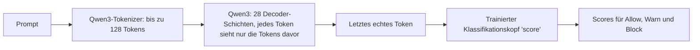

# PromptGuard – ein kleines LLM (Qwen3) mit LoRA einfach erklärt

## Warum wir ein LLM ausprobieren

Unser [Encoder mit LoRA](04_encoder_lora.md) (XLM-RoBERTa, Run 2) ist bisher das beste Modell: 548 von 600 eigenen deutschen Prompts richtig und nur 5 von 200 **Warn**-Prompts durchgelassen. Seine Schwäche ist **Block**: Er erkennt nur **179 von 200** Block-Prompts. 18 der 21 Fehler sind Passwörter im Alltagsstil, zum Beispiel „Das WLAN-Passwort ist Kaffeebohne#42“. Der Encoder stuft sie als **Warn** ein.

Unser Professor hat empfohlen, ein kleines lokales **LLM** (Large Language Model, großes Sprachmodell) mit LoRA zu testen. Unsere Frage: **Bringt das größere Sprachwissen eines LLM bessere Ergebnisse, vor allem einen höheren Block-Recall auf unseren eigenen Prompts, und ist es den Geschwindigkeitsverlust wert?**

## Was ein LLM ist

Ein **LLM** ist ein Transformer, der darauf vortrainiert wurde, das **nächste Token** eines Textes vorherzusagen, und zwar auf einer sehr großen Textmenge (Qwen3: etwa 36 Billionen Tokens laut [Qwen3 Technical Report](https://arxiv.org/abs/2505.09388)). Chat-Assistenten sind LLMs. Weil es so viel Text gesehen hat, weiß ein LLM viel über Sprache und die Welt. Es hat zum Beispiel wahrscheinlich viele Sätze gesehen, in denen ein Passwort genannt wird.

Wir lassen das LLM **keinen** Text schreiben. Wie beim Encoder setzen wir einen kleinen **Klassifikationskopf** darauf, der drei Scores ausgibt: **Allow**, **Warn** und **Block**. Der Teil des LLM, der Text schreibt (der Language-Model-Kopf), wird nicht verwendet.

## Encoder und LLM: der Unterschied

| | Encoder (XLM-RoBERTa) | LLM (Qwen3) |
|---|---|---|
| Vortrainings-Aufgabe | Verdeckte Wörter ergänzen (schaut nach links **und** rechts) | Nächstes Wort vorhersagen (schaut nur nach **links**) |
| Welches Token klassifiziert wird | Ein spezielles Start-Token, das den ganzen Text sieht | Das **letzte** Token, weil nur dieses den ganzen Prompt gesehen hat |
| Größe | ~280 Millionen Gewichte | **0,6 Milliarden** (Qwen3-0.6B) oder 1,7 Milliarden (Qwen3-1.7B) |
| Vortrainingsdaten | 2,5 TB Webtext in 100 Sprachen | ~36 Billionen Tokens in 119 Sprachen und Dialekten (Technical Report) |
| CPU-Zeit pro Prompt | ~85–110 ms (p95, Laptop) | ein Mehrfaches (wird nach dem Lauf gemessen) |

**Warum das Padding-Token wichtig ist.** Um mehrere Prompts gleichzeitig zu verarbeiten, werden kürzere Prompts mit einem *Padding-Token* aufgefüllt. Das LLM muss wissen, welches Token das ist, damit es das **letzte echte Token** jedes Prompts findet. Qwen3 hat ein solches Token (`<|endoftext|>`), aber es fehlt in der Modellkonfiguration. Deshalb trägt unser Code (`src/encoder_utils.py`) es dort ein.

## Warum Qwen3

- **Klein und offen:** Qwen3-0.6B ist eines der kleinsten aktuellen LLMs. Es passt ohne Tricks auf die kostenlose Colab-GPU (T4, 16 GB) und läuft trotzdem noch auf einer Laptop-CPU.
- **Mehrsprachig:** Die Model Card nennt „100+ languages and dialects“ (der Technical Report: 119), darunter Deutsch, Französisch und Italienisch. Wie gut ein so kleines Modell jede Sprache kann, sehen wir erst an unseren Ergebnissen.
- **Von unseren Bibliotheken unterstützt:** `transformers` 5.24.1 (unsere Version) enthält `Qwen3ForSequenceClassification`, und `peft` kann LoRA darauf anwenden.
- **Offene Lizenz:** siehe unten.

[Hugging Face – Qwen3-0.6B](https://huggingface.co/Qwen/Qwen3-0.6B)

## Lizenz von Qwen3

Qwen3-0.6B und Qwen3-1.7B stehen unter der **Apache License 2.0** (geprüft auf den Model Cards am 28.11.2026). Die Lizenz erlaubt Nutzung, Veränderung und kommerzielle Nutzung, solange Lizenztext und Copyright-Hinweise erhalten bleiben. Wichtig für uns: Unser Adapter wurde mit ai4privacy-Daten trainiert, deshalb gelten für ihn zusätzlich die **ai4privacy-Bedingungen** (siehe README, „License and data sources“).

## LoRA und QLoRA

Wie beim Encoder friert **LoRA** alle Gewichte des Basismodells ein und trainiert kleine Zusatzmatrizen (Rang `r = 16`) und den neuen Klassifikationskopf. Beim LLM setzen wir LoRA auf **alle vier Attention-Projektionen** (`q_proj`, `k_proj`, `v_proj`, `o_proj`). Das ist die übliche Einstellung für LLMs.

| | Encoder Run 2 | Qwen3-0.6B |
|---|---:|---:|
| Gewichte insgesamt | ~280 Mio. | ~600 Mio. |
| Trainierte Gewichte | 1,18 Mio. (0,42 %) | **4,59 Mio. (0,76 %)** |
| LoRA auf | `query`, `value` | `q_proj`, `k_proj`, `v_proj`, `o_proj` |
| Lernrate | 2e-4 | 1e-4 |
| Batch | 32 | 16 × 2 (Gradient Accumulation = effektiv 32) |

**QLoRA** (nur bei `MODEL_SIZE = "1.7B"`): Die eingefrorenen Basisgewichte werden mit **4 Bit** statt 32 Bit gespeichert. Das Modell wird dadurch etwa 8-mal kleiner und passt auf die T4. Die LoRA-Matrizen werden weiter in normaler Genauigkeit trainiert. 4 Bit funktioniert nur auf einer GPU. Auf dem Laptop wird das Modell deshalb ohne 4 Bit geladen, und einzelne Entscheidungen können sich leicht unterscheiden.

[Hugging Face PEFT – LoRA](https://huggingface.co/docs/peft/main/package_reference/lora) · [QLoRA-Paper (Dettmers et al., 2023)](https://arxiv.org/abs/2305.14314)

## Ein fairer Vergleich

Alles außer dem Modell ist **genau** wie bei Encoder Run 2: gleicher Split, gleiche Trainingsstichprobe (2.500 ai4privacy-Texte pro Klasse und Sprache, Seed 42, dazu alle harmlosen und alle 12.000 kurzen Trainings-Prompts = 45.845 Texte), gleiche Fingerprints, gleiche Regel für den Block-Schwellwert, gleiche `evaluate`-Funktion, gleiche eigene Prompts und Short-Prompt-Validierung. Dieser gemeinsame Code liegt in `src/train_utils.py`. Eine Prüfung hat gezeigt, dass er genau dieselbe Stichprobe erzeugt wie das Encoder-Notebook.

Nicht identisch sind die Lernrate und die LoRA-Schichten. Sie wurden vorab für ein LLM gewählt und nicht getunt. Ein Unterschied zwischen den Modellen kann also teilweise auch von diesen Einstellungen kommen.

## Ergebnisse

*Werden nach dem echten Lauf (`QUICK_TEST = False`) ergänzt.* Der Vergleich steht in `model_comparison_llm.csv` (MLflow) und in der README:

| Modell | Eigene Prompts richtig | Block erkannt | Warn → Allow | Harmlose blockiert | CPU p95 |
|---|---:|---:|---:|---:|---:|
| SVM + kurze Prompts | 486 von 600 | **191 von 200** | 20 von 200 | 28 von 200 | ~4 ms |
| Encoder Run 2 | **548 von 600** | 179 von 200 | **5 von 200** | 10 von 200 | ~85–110 ms ¹ |
| Qwen3-0.6B + LoRA | offen | offen | offen | offen | offen |

¹ Gemessen für Run 1, Run 2 hat dieselbe Modellgröße.

## Wo was zu finden ist

| Aufgabe | Ort |
|---|---|
| Training in Google Colab | [`notebooks/train_llm_lora_colab.ipynb`](../../../notebooks/train_llm_lora_colab.ipynb) |
| Laden und Vorhersage (Encoder und LLM) | [`src/encoder_utils.py`](../../../src/encoder_utils.py) |
| Gleiche Daten und Auswertung wie beim Encoder | [`src/train_utils.py`](../../../src/train_utils.py) |
| Latenz auf dem Laptop messen | [`src/measure_latency.py`](../../../src/measure_latency.py) |
| Modelle und Metriken | MLflow (DagsHub), Run `qwen3_0.6b_lora_templates` |
