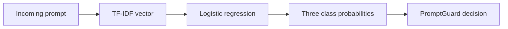
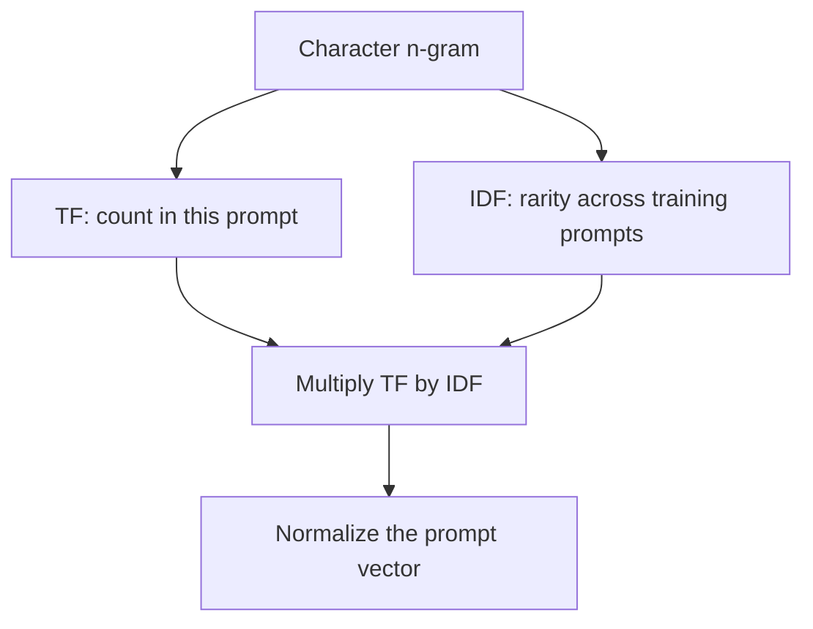
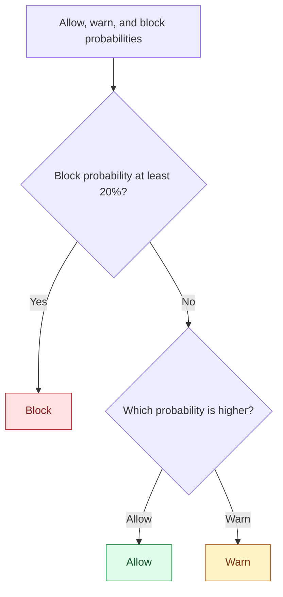

# How PromptGuard uses TF-IDF and logistic regression

PromptGuard assigns one of three actions to an incoming prompt. **Allow** lets the prompt proceed, **warn** flags it for attention, and **block** stops it. TF-IDF turns the text into numeric features. Logistic regression estimates a probability for each class. PromptGuard then applies its decision rule.

## 1. TF-IDF turns text into numeric features

PromptGuard uses **character n-grams**, which are short, overlapping sequences of characters. With scikit-learn’s default lowercasing, `IBAN` becomes `iban`. Example features include `ib`, `ba`, `an`, `iba`, `ban`, and `iban`. The `char_wb` analyzer pads word edges with spaces and keeps n-grams within each padded word. A typo can leave several features intact, and the same feature extraction works across languages. The model can learn patterns around punctuation and digits as well.

- **Term frequency (TF)** measures how often the feature appears in this prompt. With `sublinear_tf=True`, one occurrence has a TF of 1 and three occurrences have a TF of about 2.10, using `1 + ln(count)`.
- **Inverse document frequency (IDF)** gives greater weight to features that occur in fewer training prompts. If `iban` and `plea` each appear once in a prompt and `iban` occurs in fewer training prompts, `iban` receives a higher TF-IDF value.
- **TF-IDF vector** contains one value per retained feature. Absent features have value zero. With scikit-learn’s default L2 normalization, a nonzero vector is scaled to length 1.

The vectorizer learns the vocabulary and IDF values from the training split. It reuses them when transforming validation, test, and incoming prompts.

### Vectorizer settings

| Parameter | Project value | What it controls |
|---|---|---|
| `analyzer` | `char_wb` | Extracts character sequences within padded word boundaries. |
| `ngram_range` | `(2, 5)` | Includes short fragments and longer patterns. |
| `min_df` | `5` | Keeps features that occur in at least five training prompts. A higher value reduces the vocabulary and may discard useful rare signals. |
| `max_features` | `300_000` | Caps the vocabulary at the most frequent eligible features by total training-corpus count. A lower cap reduces memory use. |
| `sublinear_tf` | `True` | Reduces the influence of repeated occurrences within a single prompt. |

[scikit-learn TfidfVectorizer documentation](https://scikit-learn.org/stable/modules/generated/sklearn.feature_extraction.text.TfidfVectorizer.html)

## 2. Logistic regression estimates class probabilities

During training, the model uses prompts labelled `allow`, `warn`, and `block`. It learns a separate weight for each feature in each class and an intercept for each class by minimizing weighted log loss with regularization. During prediction, it multiplies each TF-IDF feature value by its learned weight and adds the contributions and intercept. **Softmax** converts the three resulting scores into probabilities that sum to 100%.

**Class score = intercept + sum of (TF-IDF value × learned class weight)**

### Worked example

Suppose the prompt “Summarise this IBAN example” has two active features in a simplified model, `summ` with a value of 0.60 and `iban` with a value of 0.80. The feature values, weights, and probabilities below are illustrative.

| Class | Intercept | Contribution from `summ` | Contribution from `iban` | Class score | Softmax probability |
|---|---:|---:|---:|---:|---:|
| Allow | +0.40 | 0.60 × 1.20 | 0.80 × −0.40 | 0.80 | 47.2% |
| Warn | 0.00 | 0.60 × 0.00 | 0.80 × 0.50 | 0.40 | 31.6% |
| Block | 0.00 | 0.60 × −0.80 | 0.80 × 0.60 | 0.00 | 21.2% |

### Classifier and decision settings

| Setting | Project value | What it controls |
|---|---|---|
| `C` | `1` baseline, `30` tuned | Inverse regularization strength. Smaller values shrink the weights more. Larger values let the model fit the training data more closely and may increase overfitting. |
| `class_weight` | `"balanced"` | Gives examples from less frequent classes more weight in the training loss. |
| Block threshold | `0.20` in the tuned variant | Gives `block` priority when its estimated probability reaches 20%. Applied after prediction. |

For a reproducible configuration, record the scikit-learn version, optimizer (`solver`), regularization penalty, and `max_iter` from your training code. The solver must support multinomial logistic regression for the softmax explanation above.

[scikit-learn LogisticRegression documentation](https://scikit-learn.org/stable/modules/generated/sklearn.linear_model.LogisticRegression.html)

## 3. PromptGuard applies the block threshold

| P(allow) | P(warn) | P(block) | Highest probability (argmax) | PromptGuard action |
|---:|---:|---:|---|---|
| 75% | 15% | 10% | Allow | **Allow** |
| 30% | 55% | 15% | Warn | **Warn** |
| 47.2% | 31.6% | 21.2% | Allow | **Block** |

In the worked example, `allow` has the highest probability. The tuned rule returns `block` because 21.2% clears the 20% threshold. Lowering the threshold can catch more true block cases while increasing false blocks. The 20% is a cutoff on the model output. Its interpretation as a real-world risk estimate depends on probability calibration.

## 4. Validation results

| Version | Macro F1 | Block recall |
|---|---:|---:|
| Baseline (`C = 1`, argmax) | 0.870 | 91.8% |
| Tuned (`C = 30`, block threshold 0.20) | 0.864 | **95.5%** |

The tuned variant reached the project’s **95% block-recall target** on the validation set. Block recall increased by **3.7 percentage points** and macro F1 decreased by **0.006**. Macro F1 gives equal weight to the F1 of each class. Reported inference time was about **3 ms per prompt**. Both `C` and the decision rule changed in this comparison, so the table shows their combined effect. When choosing settings, evaluate `C` and the threshold on validation data and measure final performance on a held-out test set.

## What the model can explain

For any prediction, the feature contributions show which fragments raised or lowered each class score. Character n-grams can capture recurring spellings and formats efficiently. The classifier adds their contributions independently and has limited access to context beyond those short fragments. For example, it can learn that parts of `anna` correlate with names, but it may miss a name in a new context or flag a generic mention of sensitive information.

