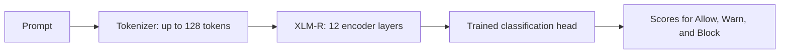
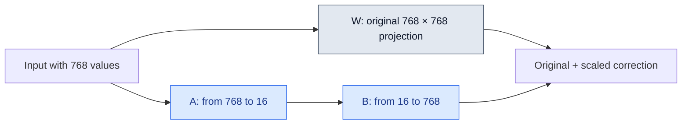
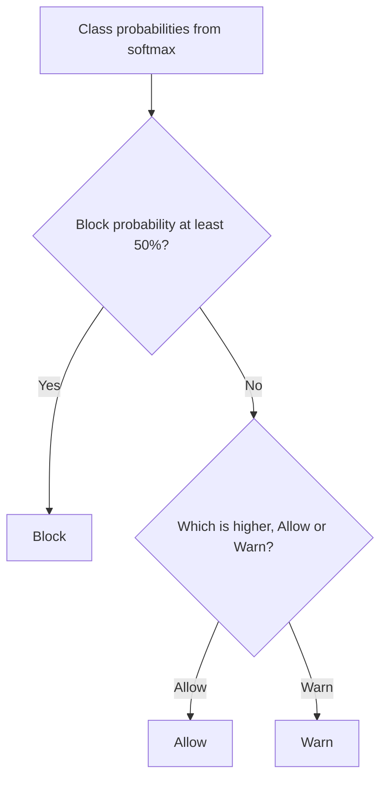

# PromptGuard – XLM-RoBERTa with LoRA, explained simply

## Why we tried an encoder

[TF-IDF](01_tfidf.md) with [logistic regression](02_logistische_regression.md) or a [linear SVM](03_lineare_svm.md) scores short character sequences. These models can learn which fragments often appear in **Warn** prompts. Much of the sentence context is lost in the representation.

After training on benign prompts, the best SVM let **15 out of 60 Warn prompts** through in one check. One example was “Schreib eine Geburtstagsnachricht für meine Kollegin Emily Schwarz.” (“Write a birthday message for my colleague Emily Schwarz.”) Our interpretation was that the SVM classified short requests as **Allow** too often. This check with 60 prompts is a separate evaluation from the 600-prompt test shown below.

**Our idea** is to use a pretrained language model that processes words in context. With **LoRA**, we adapt it to the three classes **Allow**, **Warn**, and **Block** by training a small set of additional weights.

## What the encoder sees in the prompt

| Example | What the model does with it |
|---|---|
| **Prompt** | “Schreib eine Mail an Emily Schwarz wegen des Vertrags.” (“Write an email to Emily Schwarz about the contract.”) |
| **TF-IDF** | Weights fragments such as “emi,” “mil,” “ily,” “sch,” and “chw.” |
| **Encoder** | Also uses context. “Mail an” (“email to”) suggests a recipient. That context can help the model recognize “Emily Schwarz” as a person’s name and contribute to a **Warn** prediction. |

An **encoder** is a transformer that converts text into numbers that reflect context. Through **self-attention**, each token can incorporate information from other tokens in the input. This helps the model use clues in the sentence even for names it has never seen during training. A text-generating decoder, such as the kind used by ChatGPT, generates text step by step. PromptGuard only needs to read and classify the prompt.

- **Base model:** XLM-RoBERTa base (`FacebookAI/xlm-roberta-base`), pretrained on text in **100 languages**, including German, English, French, and Italian.
- **Size:** Around **280 million weights** in a model with **12 encoder layers**.
- **Tokens:** The tokenizer breaks text into units, often pieces of words. “Urlaubs” · “regel” · “ung” is a simplified example of splitting the German word for a vacation policy. Our run processes up to **128 tokens per prompt**.
- **Classification head:** A newly initialized module produces three scores, one for each of **Allow**, **Warn**, and **Block**. The head learns alongside the LoRA matrices. Softmax converts those scores into class probabilities.

[Hugging Face – XLM-RoBERTa base](https://huggingface.co/FacebookAI/xlm-roberta-base)

## How LoRA reduces what we have to train

Full fine-tuning updates all roughly 280 million weights. This takes more GPU resources and produces a checkpoint of about 1 GB at the scale considered here. **LoRA (Low-Rank Adaptation)** freezes the base model and learns a small correction to the `query` and `value` projections in each attention layer.

For an adapted projection, **output = W·x + (α/r)·B·A·x**. Using column vectors, A has shape **16 × 768** and B has shape **768 × 16**. A projects the input down to 16 values, and B projects the correction back up to 768 values. We train A, B, and the classification head.

| Comparison | Full fine-tuning | LoRA in our run |
|---|---:|---:|
| Trainable weights | Around 280M (100%) | **1.18M (0.42%)** |
| LoRA matrices | – | 0.59M (12 layers × 2 projections) |
| Classification head | Part of the full model | 0.59M |
| Saved file | Approx. 1 GB | **Adapter approx. 5 MB** |
| Training time for comparison (Colab, T4 GPU) | Hours (rough estimate) | **Approx. 10 minutes** |

The saved **adapter** contains the LoRA matrices and the classification head. For inference, we load the base model from Hugging Face at a **fixed commit hash** and attach the adapter. `merge_and_unload` then folds the LoRA correction into the base weights. This removes the separate computation path at inference. The prediction is mathematically equivalent, subject to rounding differences.

[Hugging Face PEFT – LoRA](https://huggingface.co/docs/peft/main/package_reference/lora)

## Which settings we chose

| Setting | Value | What it means |
|---|---|---|
| `r` (rank) | `16` | Sets the intermediate width of A and B. A higher rank makes the correction more flexible and adds trainable weights. |
| `lora_alpha` | `32` | Scales the correction. Here, `alpha / r = 2`. |
| `lora_dropout` | `0.1` | Randomly zeros 10% of the inputs to the LoRA branch during training to reduce overfitting. |
| Learning rate | `2e-4` | Sets the size of each training update. This is higher than typical full fine-tuning because only the adapter and head are updated. |
| Epochs | Max. `3` | An epoch is one pass through the training data. **Early stopping** can end training sooner when validation performance stops improving. |
| `max_length` | `128` tokens | Inputs beyond the limit are truncated. This affects 0.3% of the training texts in this run. |
| Block threshold | **`0.5`** | Uses the same decision logic as TF-IDF/SVM. According to the project notes, 0.5 was the highest tested threshold that met both selection objectives. The notes do not specify the two target values. |

## Training data and the two MLflow runs

The transformer requires more computation than TF-IDF. We trained it on a **balanced sample** of **2,500 ai4privacy texts per class and language** plus all benign prompts.

| MLflow run | Training data | Texts |
|---|---|---:|
| Run 1 – `xlmr_lora_benign` | Sample + benign prompts | 33,845 |
| Run 2 – `xlmr_lora_benign_templates` | Same as Run 1 + **12,000 short prompts** from `src/short_prompts.py` | 45,845 |

According to the project notes, the other settings were identical. That lets us compare what happened when we added short prompts to the same training setup.

## Results

### ai4privacy validation set (31,380 texts)

| Model | Macro F1 | Block recall | Block recall (German) |
|---|---:|---:|---:|
| Linear SVM + benign prompts | 0.862 | 0.957 | 0.956 |
| **Encoder Run 1** | **0.963** | **0.994** | **0.994** |
| **Encoder Run 2** | **0.966** | **0.993** | **0.993** |

### Our test with 600 German prompts (200 per class)

| Model | Correct | Macro F1 | Warn → Allow | Block detected | Benign prompts blocked |
|---|---:|---:|---:|---:|---:|
| SVM + benign prompts | 455 | 0.752 | 51 of 200 | 190 of 200 | 29 of 200 |
| SVM + short prompts | 486 | 0.806 | 20 of 200 | **191 of 200** | 28 of 200 |
| **Encoder Run 1** | **548** | **0.914** | 6 of 200 | 177 of 200 | **7 of 200** |
| **Encoder Run 2** | **548** | **0.914** | **5 of 200** | 179 of 200 | 10 of 200 |

**Macro F1** weights the F1 score of each class equally. **Block recall** measures the share of prompts labelled Block that the model correctly blocked. Run 2 achieved **99.3%** block recall on ai4privacy and **89.5%** on our own test (179 of 200). These results come from different datasets.

For **CPU latency**, we measured one prompt at a time on the same laptop. The SVM took **about 3.5 ms** and the encoder took **about 85–110 ms at p95**. The p95 is the time at or below which about 95% of measurements fall.

## What we learned from the errors

- **Context helps on Warn prompts.** The encoder let through only 5 to 6 out of 200 Warn prompts. The SVM let through 20 to 51. The encoder also blocked far fewer benign prompts.
- **The extra short prompts mainly helped the SVM.** Both encoder runs scored 548 correct predictions and a macro F1 of 0.914 on our test. The results suggest that the “short request = Allow” tendency was already less pronounced for the encoder on this test.
- **Passwords remain a weak spot.** In Run 2, 18 of the 21 missed Block prompts contained a password, such as “Das WLAN-Passwort ist Kaffeebohne#42” (“The Wi-Fi password is Kaffeebohne#42”). The error analysis found that cases like these almost always received **Warn**. Our hypothesis is that training passwords tend to resemble random strings (e.g., “fpSHzqU6nKrZ”), while our own examples more often use a word and a number.
- **Business reference numbers are hard to distinguish.** In the error analysis, 20 of the 23 errors on benign prompts involved order, ticket, or invoice numbers. The model mistook them for account numbers (**Block**) or identifiers (**Warn**). The notes do not specify which run those 23 cases came from.

## SVM and encoder compared

| Aspect | Linear SVM with TF-IDF | XLM-R encoder with LoRA |
|---|---|---|
| Text features | Character sequences | Tokens in context |
| Prior language knowledge | Learns from the project data | Pretrained on 100 languages |
| Training | Minutes on the laptop | Approx. 10 minutes on a Colab GPU |
| Model size | Approx. 16 MB | Approx. 5 MB adapter plus approx. 1 GB base model |
| CPU latency | Approx. 3.5 ms | Approx. 85–110 ms (p95), roughly 25 to 30 times slower |
| Names and emails (Warn) | Weaker in the project evaluation | Stronger in the project evaluation |
| Passwords (Block) | Stronger in the project evaluation | Weaker on everyday-style passwords |

The encoder can use context to detect clues about names it has never seen. It starts with multilingual pretraining, adapts quickly with a small adapter, and was tested using the same evaluation as the other models. The documented training run used a GPU. The approximately 1 GB base model must be available when serving predictions.

## Where to find things

| Task | Location |
|---|---|
| Training in Google Colab | [`notebooks/train_encoder_lora_colab.ipynb`](../../../notebooks/train_encoder_lora_colab.ipynb) |
| Loading and inference | [`src/encoder_utils.py`](../../../src/encoder_utils.py) |
| Measuring latency on the laptop | [`src/measure_latency.py`](../../../src/measure_latency.py) |
| Evaluating our own prompts | [`src/evaluate_own_prompts.py`](../../../src/evaluate_own_prompts.py) |
| Models and metrics | MLflow (DagsHub), runs `xlmr_lora_benign` and `xlmr_lora_benign_templates` |
