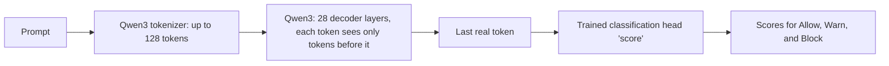

# PromptGuard – a small LLM (Qwen3) with LoRA, explained simply

## Why we try an LLM

Our [encoder with LoRA](04_encoder_lora.md) (XLM-RoBERTa, run 2) is the best model so far: 548 of 600 own German prompts correct and only 5 of 200 **Warn** prompts let through. Its weak spot is **Block**: it catches only **179 of 200** Block prompts. 18 of the 21 misses are passwords written in everyday style, such as “Das WLAN-Passwort ist Kaffeebohne#42” (“The Wi-Fi password is Kaffeebohne#42”). The encoder classifies these as **Warn**.

Our professor suggested trying a small local **LLM** (large language model) with LoRA. Our question: **does the bigger language knowledge of an LLM give better results, above all a higher Block recall on our own prompts, and is it worth the loss in speed?**

## What an LLM is

An **LLM** is a transformer that was pre-trained to **predict the next token** of a text, on a very large amount of text (Qwen3: about 36 trillion tokens, according to the [Qwen3 technical report](https://arxiv.org/abs/2505.09388)). Chat assistants are LLMs. Because it has seen so much text, an LLM knows a lot about language and the world. For example, it may have seen many sentences in which a password is mentioned.

We do **not** use the LLM to write text. As with the encoder, we put a small **classification head** on top that outputs three scores: **Allow**, **Warn**, and **Block**. The part of the LLM that writes text (the language-model head) is not used.

## Encoder and LLM: the difference

| | Encoder (XLM-RoBERTa) | LLM (Qwen3) |
|---|---|---|
| Pre-training task | Fill in masked words (looks left **and** right) | Predict the next word (looks only **left**) |
| Which token is classified | A special start token that sees the whole text | The **last** token, because only it has seen the whole prompt |
| Size | ~280 million weights | **0.6 billion** (Qwen3-0.6B) or 1.7 billion (Qwen3-1.7B) |
| Pre-training data | 2.5 TB of web text in 100 languages | ~36 trillion tokens in 119 languages and dialects (technical report) |
| CPU time per prompt | ~85–110 ms (p95, laptop) | several times more (measured after the run) |

**Why the padding token matters.** To process several prompts at once, shorter prompts are filled up with a *padding token*. The LLM must know which token that is, so it can find the **last real token** of each prompt. Qwen3 has such a token (`<|endoftext|>`), but it is missing in the model configuration, so our code (`src/encoder_utils.py`) writes it there.

## Why Qwen3

- **Small and open:** Qwen3-0.6B is one of the smallest current LLMs. It fits on the free Colab GPU (T4, 16 GB) without tricks and still runs on a laptop CPU.
- **Multilingual:** the model card names “100+ languages and dialects” (the technical report: 119), including German, French, and Italian. How well a model this small knows each language, we can only see in our results.
- **Supported by our libraries:** `transformers` 5.24.1 (our version) has `Qwen3ForSequenceClassification`, and `peft` can add LoRA to it.
- **Open license:** see below.

[Hugging Face – Qwen3-0.6B](https://huggingface.co/Qwen/Qwen3-0.6B)

## License of Qwen3

Qwen3-0.6B and Qwen3-1.7B are published under the **Apache License 2.0** (checked on the model cards on 2026-11-28). This license allows use, changes, and commercial use, provided the license text and copyright notices are kept. Important for us: our trained adapter was trained on ai4privacy data, so the **ai4privacy terms** also apply to it (see the README, “License and data sources”).

## LoRA and QLoRA

As with the encoder, **LoRA** freezes all weights of the base model and trains small additional matrices (rank `r = 16`) plus the new classification head. For the LLM we put LoRA on **all four attention projections** (`q_proj`, `k_proj`, `v_proj`, `o_proj`), which is the usual setting for LLMs.

| | Encoder run 2 | Qwen3-0.6B |
|---|---:|---:|
| Weights in total | ~280 M | ~600 M |
| Trainable weights | 1.18 M (0.42 %) | **4.59 M (0.76 %)** |
| LoRA on | `query`, `value` | `q_proj`, `k_proj`, `v_proj`, `o_proj` |
| Learning rate | 2e-4 | 1e-4 |
| Batch | 32 | 16 × 2 (gradient accumulation = effective 32) |

**QLoRA** (only with `MODEL_SIZE = "1.7B"`): the frozen base weights are stored with **4 bits** instead of 32. The model gets about 8 times smaller and fits on the T4. The LoRA matrices are still trained in normal precision. 4-bit only works on a GPU, so on the laptop the model is loaded without 4 bits; a few decisions can then differ.

[Hugging Face PEFT – LoRA](https://huggingface.co/docs/peft/main/package_reference/lora) · [QLoRA paper (Dettmers et al., 2023)](https://arxiv.org/abs/2305.14314)

## A fair comparison

Everything except the model is **exactly** as in encoder run 2: same split, same training sample (2,500 ai4privacy texts per class and language, seed 42, plus all harmless and all 12,000 short train prompts = 45,845 texts), same fingerprints, same block threshold rule, same `evaluate` function, same own prompts and short-prompt validation. This shared code lives in `src/train_utils.py`; a check proved that it produces exactly the same sample as the encoder notebook.

Not identical: the learning rate and the LoRA layers (chosen in advance for an LLM, not tuned). A difference between the models can partly come from these settings.

## Results

*Will be added after the real run (`QUICK_TEST = False`).* Compared in `model_comparison_llm.csv` (MLflow) and in the README:

| Model | Own prompts correct | Block caught | Warn → Allow | Harmless blocked | CPU p95 |
|---|---:|---:|---:|---:|---:|
| SVM + short prompts | 486 of 600 | **191 of 200** | 20 of 200 | 28 of 200 | ~4 ms |
| Encoder run 2 | **548 of 600** | 179 of 200 | **5 of 200** | 10 of 200 | ~85–110 ms ¹ |
| Qwen3-0.6B + LoRA | open | open | open | open | open |

¹ Measured for run 1; run 2 has the same model size.

## Where to find things

| Task | Location |
|---|---|
| Training in Google Colab | [`notebooks/train_llm_lora_colab.ipynb`](../../../notebooks/train_llm_lora_colab.ipynb) |
| Loading and inference (encoder and LLM) | [`src/encoder_utils.py`](../../../src/encoder_utils.py) |
| Same data and evaluation as the encoder | [`src/train_utils.py`](../../../src/train_utils.py) |
| Measuring latency on the laptop | [`src/measure_latency.py`](../../../src/measure_latency.py) |
| Models and metrics | MLflow (DagsHub), run `qwen3_0.6b_lora_templates` |
